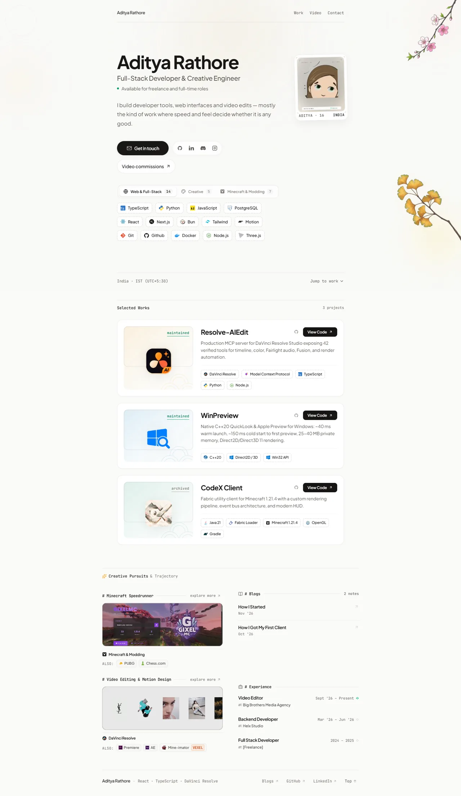

# Portfolio

Personal portfolio for **Aditya Rathore** — full-stack developer and video editor.
Built with React 19 and Vite, with a hand-drawn Japanese paper art direction and
static entry points for each section.

[](https://github.com/Code-Xceed/portfolio/actions/workflows/verify.yml)



The site has five entry points, all pre-rendered as static HTML and then hydrated:

| Route | Content |
|---|---|
| `/` | Hero, selected work, creative pursuits, experience, footer |
| `/interests/video-editing/` | Commission page: reels by niche, client contact, brief |
| `/interests/minecraft/` | Speedrunning clip, Modrinth work, other games |
| `/blogs/how-i-started/` | Written note |
| `/blogs/how-i-got-my-first-client/` | Written note |

## Stack

- **React 19** with Vite 8 (rolldown) and five HTML entries
- **Tailwind CSS v4** for styling, with a small set of paper/texture tokens in `src/index.css`
- **lucide-react** for icons, tree-shaken
- **Puppeteer** (dev only) for the repository's verification scripts
- No runtime state library, no router package — routing is a small resolver in `src/App.jsx`

## Structure

```
.
├── .github/
│   ├── workflows/                 # CI: verify, and dispatch-only Pages deploy
│   ├── is-a-dev/codex.json        # domain record for the is-a.dev pull request
│   ├── screenshot.webp            # README preview
│   └── social-preview.png         # 1280x640 repository social preview
├── blogs/*/index.html             # pre-rendered blog entries
├── interests/*/index.html         # pre-rendered section entries
├── public/                        # images, video, icons, sitemap, robots
├── scripts/
│   ├── verify.mjs                 # budgets and banned-content gate
│   ├── check-assets.mjs           # every referenced asset must exist in dist
│   └── send-blog-update.js        # manual newsletter send (Gmail SMTP)
├── src/
│   ├── components/                # one component per section or surface
│   ├── App.jsx                    # route resolver, sheet, focus and scroll handling
│   ├── index.css                  # tokens, texture, motion
│   └── post.jsx                   # standalone blog entry
├── index.html
├── vite.config.js
└── package.json
```

## Development

Requires Node 20+.

```bash
npm install
npm run dev        # http://localhost:5173
npm run build      # static output in dist/
npm run preview    # serve the production build
npm run verify     # quality gates (run after build)
```

## Quality gates

`npm run verify` fails the build when any of these regress:

| Gate | Budget |
|---|---|
| JavaScript | ≤ 120 kB gzip total, no separate icon chunk |
| `public/` payload | ≤ 80 MB, no single asset over 20 MB |
| Retracted claims | must not reappear in source or the SEO fallback |
| Type floor | no text below 10px |
| Primary action | must remain a real `mailto:` |
| Video loading | `preload` required, unconditional `autoplay` forbidden |

`node scripts/check-assets.mjs` additionally verifies that every asset referenced
by the built HTML, CSS and JS actually exists in `dist/`.

`node scripts/check-seo.mjs` verifies, for all five entry points: title and
description length, canonical and `og:url` agreement, `og:image`, a single `h1`,
and the required JSON-LD types (`Person`, `ItemList`, `CollectionPage`,
`BlogPosting`, `BreadcrumbList`). It also checks that `robots.txt` points at the
sitemap and that every page appears in it.

The same gates run on every push and pull request via `.github/workflows/verify.yml`.

## Deployment

The build is a plain static bundle and `public/CNAME` targets `codex.is-a.dev`.
`.github/workflows/deploy.yml` builds, runs the gates, and publishes `dist/` to
GitHub Pages.

Order matters, because `CNAME` makes Pages claim the custom domain immediately:

1. **Claim the subdomain.** Copy `.github/is-a-dev/codex.json` to
   `domains/codex.json` in a fork of [`is-a-dev/register`](https://github.com/is-a-dev/register)
   and open a pull request. It points `codex.is-a.dev` at `code-xceed.github.io`.
2. **Wait for the record to merge and resolve** (`nslookup codex.is-a.dev`).
3. **Enable Pages:** Settings → Pages → Source: **GitHub Actions**.
4. **Run the `deploy` workflow** from the Actions tab.

Until step 2 completes, do not enable Pages: the `CNAME` file would point the
site at a domain that does not resolve yet. Once the domain is live, add the
`push` trigger to `deploy.yml` so every push to `main` publishes.

There is no newsletter backend. Each note ends with a `mailto:` so the promise
in the copy is one a static site can keep.

## Adding content

| To add | Edit |
|---|---|
| A project card | `PROJECTS` in `src/components/SelectedWorks.jsx` |
| A blog post | `POSTS` in `src/components/blogPosts.jsx` plus an entry HTML file |
| A video or reel | `CATEGORIES` in `src/components/VideoEditingExplorePage.jsx` |
| Experience or a hobby line | `EXPERIENCES` / card copy in `src/components/InterestsExperience.jsx` |
| Navigation | `src/components/Nav.jsx` |

Keep the claims on a card checkable. Every number should be traceable to the
linked repository or removed.

## Accessibility and performance

- WCAG 2.2 AA contrast, measured; a 10px minimum type size; 24px minimum targets.
- The section sheet is a real modal: the page behind it is `inert`, focus moves in
  on open and returns to the trigger on close, and one Back press leaves the site.
- `prefers-reduced-motion` stops every video, not only CSS animation.
- No video bytes before intent; poster-first previews.
- Images are WebP with `srcset` where it matters; decorative mobile art is
  downscaled rather than shipped full size.

## License

[MIT](LICENSE) © Aditya Rathore
